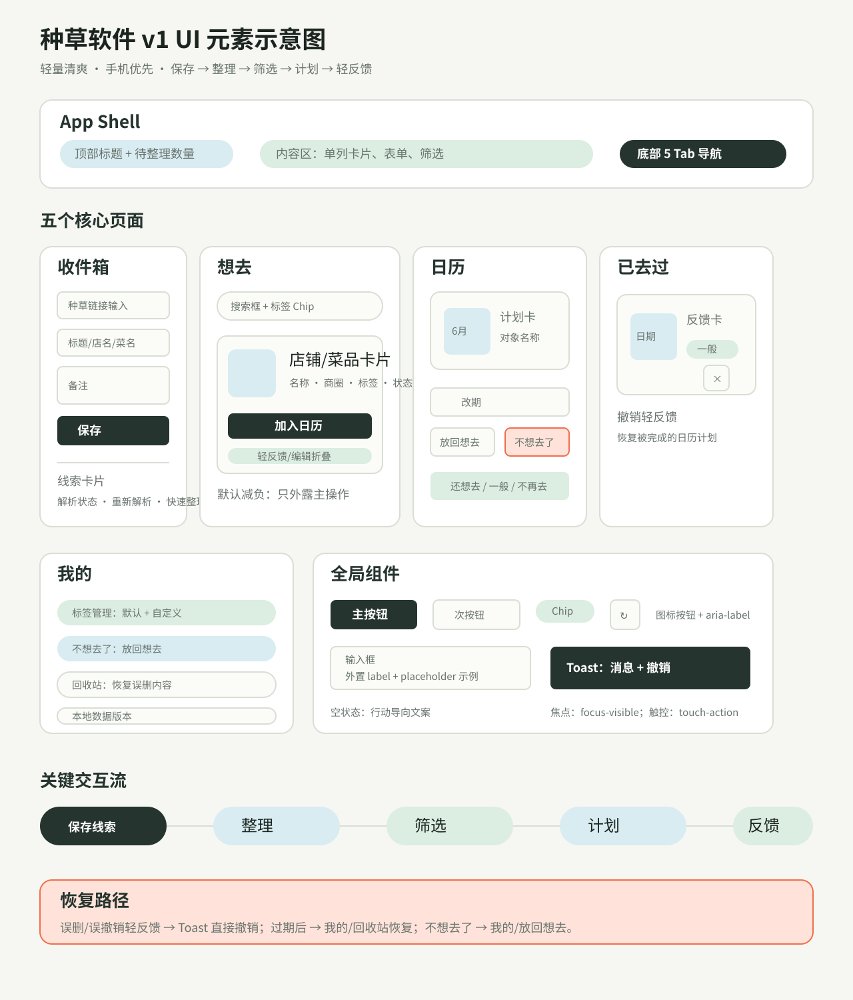

# 种草软件 v1 前端设计方案

更新日期：2026-05-25

## 1. 设计目标

种草软件 v1 的前端目标不是做展示型页面，而是做一个手机优先、低负担、可长期自用的个人美食收集工具。用户应该能在 15 秒内保存一条线索，在想吃时快速按标签、商圈、店铺/菜品筛选，并把收藏转成某天要去的计划。

设计关键词：

- **轻量清爽**：减少装饰和心理负担，让记录像临时放进口袋。
- **快速行动**：保存、整理、计划、轻反馈都要在手机上顺手完成。
- **可恢复**：误删、误标记、误点“不想去了”要有明显恢复路径。
- **卡片可扫**：每张店铺/菜品卡片先服务判断，不堆满表单。

## 2. 互联网调研结论与 UI 元素选择

本轮 UI 元素参考了 Apple Human Interface Guidelines、Material Design、W3C WCAG 与 Vercel Web Interface Guidelines。选择原则是：移动端熟悉、触控友好、语义明确、不过度打扰。

| UI 元素 | 最终选择 | 调研依据 | 本项目应用 |
| --- | --- | --- | --- |
| 底部导航 | 5 个固定 Tab：收件箱、想去、日历、已去过、我的 | Apple HIG 建议 Tab Bar 用于最常访问的主区域，默认不超过 5 个更利于紧凑/常规尺寸一致性。 | 保持固定底部导航，所有核心任务一跳到达。 |
| 卡片 | 店铺/菜品/计划/反馈统一卡片 | Material Cards 适合承载单一主题的内容和操作，要求可扫描、有层级。 | 店铺/菜品卡片优先显示名称、类型、商圈/绑定店铺、标签和主操作。 |
| 标签/筛选 | Chip 作为标签与筛选控件 | Material Chips 适合表示属性、筛选、选择和轻操作。 | 标签筛选、默认标签、自定义标签统一使用 chip。 |
| 表单输入 | 外置 label + placeholder 示例 + helper 式文案 | Material Text Fields 强调 label、输入状态、辅助说明；Vercel 指南要求表单控件有 label。 | 保存链接、整理线索、编辑资料均保留可见 label，placeholder 只作例子。 |
| Toast/Snackbar | 底部短反馈 + 单个“撤销”动作 | Material Snackbars 用于短暂反馈，不应打断流程，可包含单个动作。 | 保存、删除、恢复、计划更新都用 toast；误删提供“撤销”。 |
| 触控目标 | 主要交互目标接近或达到 44px | W3C WCAG 2.5.5 建议触控目标 44×44 CSS px。 | 底部导航 44px，高频按钮 40px 起，图标按钮独立触控区。 |
| 图标按钮 | 视觉符号 + `aria-label` | Vercel Web Interface Guidelines 要求 icon-only button 提供 `aria-label`。 | 重新解析、移入回收站、撤销轻反馈都补充明确语义。 |

参考来源：

- Apple Human Interface Guidelines: [Tab bars](https://developer.apple.com/design/human-interface-guidelines/tab-bars/)
- Material Design: [Cards](https://m2.material.io/components/cards)
- Material Design: [Chips](https://m2.material.io/components/chips/android)
- Material Design: [Snackbars](https://m2.material.io/components/snackbars)
- Material Design: [Text fields](https://m2.material.io/components/text-fields)
- W3C WAI: [Understanding Success Criterion 2.5.5 Target Size](https://www.w3.org/WAI/WCAG21/Understanding/target-size.html)
- Vercel Labs: [Web Interface Guidelines](https://raw.githubusercontent.com/vercel-labs/web-interface-guidelines/main/command.md)

## 3. 信息架构

v1 保持 5 个底部入口：

- **收件箱**：粘贴链接、手动补充、待整理线索。
- **想去**：未去过店铺和菜品的主决策页，支持搜索、筛选、图列/列表。
- **日历**：已计划内容，只按日期，不做复杂时间轴。
- **已去过**：轻反馈历史，只展示日期、对象和三按钮判断。
- **我的**：标签、不想去了、回收站、本地数据状态。

首屏优先级：

1. 收件箱：链接输入与保存按钮。
2. 想去：筛选 + 店铺/菜品卡片。
3. 日历：最近计划。
4. 已去过：反馈记录。
5. 我的：恢复和管理。

## 4. 核心组件规范

### 4.1 App Shell

- 顶部：当前 Tab 标题 + 待整理数量。
- 内容区：单列移动端布局，最大宽度 720px。
- 底部：固定 5 Tab，保留 safe-area 底部空间。

### 4.2 收件箱输入

- 字段：种草链接、标题/店名/菜名、备注。
- 链接字段使用 `type="url"` 与 `inputmode="url"`。
- 解析失败或低信息解析时，标题/店名/菜名成为必填兜底。
- 空状态文案改为行动导向：“粘贴一个链接开始收集”。

### 4.3 线索整理卡片

- 顶部：来源平台、内容类型、标题、重新解析按钮。
- 中部：原始链接与解析失败提示。
- 底部：店铺、菜品、城市、商圈、地址备注、标签、整理备注。
- 操作：保存为店铺、保存为菜品、店铺 + 菜品、暂留。

### 4.4 想去卡片

- 信息层级：封面/占位图 → 类型 → 名称 → 商圈/绑定店铺/状态 → 标签。
- 主操作：计划日期 + 加入日历，保持外露。
- 次操作：到店轻反馈折叠，减少卡片默认密度。
- 编辑资料继续折叠，避免把想去列表变成表单列表。
- 删除使用图标按钮，但必须有 `aria-label="移入回收站"`，删除后 toast 提供“撤销”。

### 4.5 日历计划卡

- 左侧日期块，右侧计划对象。
- 改期为主编辑操作。
- “放回想去”和“不想去了”并列，后者表示对该目标整体不想去了。
- 到店轻反馈按钮在日历卡外露，因为这是计划完成的关键动作。

### 4.6 已去过卡片

- 展示日期、店铺/菜品、反馈值。
- 撤销轻反馈使用图标按钮并提供 `aria-label="撤销轻反馈"`。
- 撤销后 toast 可直接恢复，减少去“我的”里找回的负担。

### 4.7 Toast 与撤销

- Toast 使用 `role="status"`、`aria-live="polite"`、`aria-atomic="true"`。
- 只承载一个短消息和一个可选动作。
- 删除/撤销类操作提供“撤销”按钮。
- 位置保持在底部导航上方，避免遮住常用触控区。

## 5. 视觉方向

色彩：

- 背景：浅暖灰绿 `#f6f7f2`。
- 主色：深叶绿 `#26342f`，用于主按钮、选中态、强调文字。
- 辅助色：浅叶绿、天空蓝、番茄橙、金色，用于轻提示和占位图。
- 不使用大面积紫蓝渐变、重营销装饰或过厚阴影。

排版：

- 优先系统可用中文字体：`Avenir Next`、`PingFang SC`、`Noto Sans CJK SC`。
- 标题克制，卡片内不使用过大字号。
- 长店名、长标签、长链接必须可换行，不允许撑破卡片。

布局：

- 移动端默认单列。
- 图列模式在小屏仍保持单列，避免双列卡片过窄。
- 页面段落使用 full-width 内容区，不嵌套卡片。

## 6. 可访问性与交互规范

- 图标按钮必须有 `aria-label`。
- Toast 必须有 live region。
- 交互控件使用 `touch-action: manipulation`。
- 所有按钮、summary、输入控件必须有 `:focus-visible`。
- 关键按钮的可点区域接近或达到 44px。
- 删除类操作不弹阻断确认，使用 toast 撤销降低打断。
- 日期使用本地化格式展示。

## 7. UI 元素示意图

完整示意图见：

## 8. 当前已落地调整

- Toast 增加 `role="status"`、`aria-live="polite"`、`aria-atomic="true"`。
- 删除/撤销轻反馈后 toast 提供快捷“撤销”。
- 重新解析、移入回收站、撤销轻反馈按钮增加 `aria-label`。
- 想去卡片中“到店轻反馈”折叠，保留“加入日历”为主操作。
- 空状态改为行动导向文案。
- 表单 placeholder 改为示例式省略号文案，并给非认证字段补 `autocomplete="off"`。
- CSS 增加 `touch-action: manipulation` 与 `:focus-visible`。

## 9. 验收标准

- 手机宽度 390px 下，收件箱首屏能直接保存链接。
- 想去卡片默认不显得像表单堆叠，主操作“加入日历”清晰。
- 删除任意店铺/菜品/轻反馈后，可直接在 toast 撤销。
- 键盘 Tab 导航时能看到焦点位置。
- 辅助工具能读到 toast 状态变化。
- `npm test` 全部通过。
